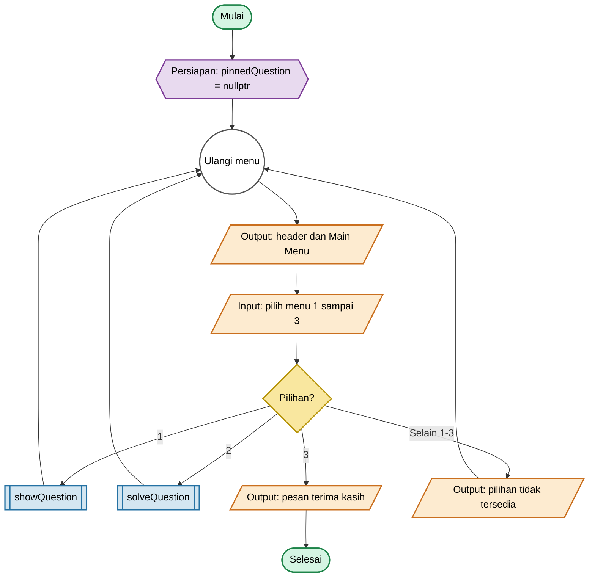
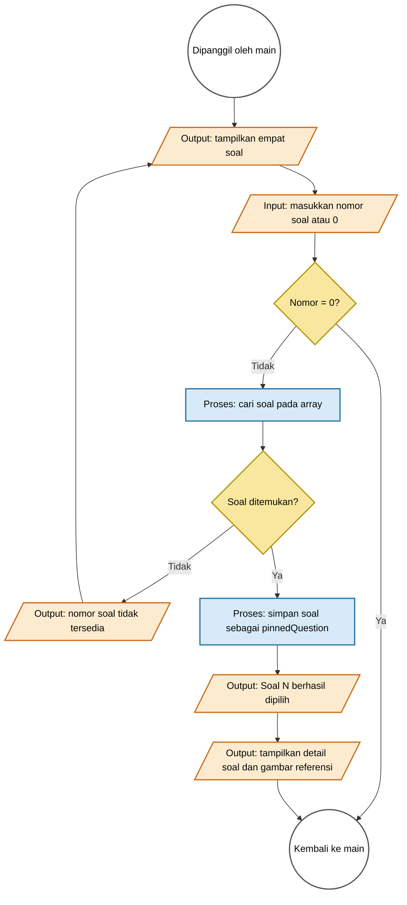
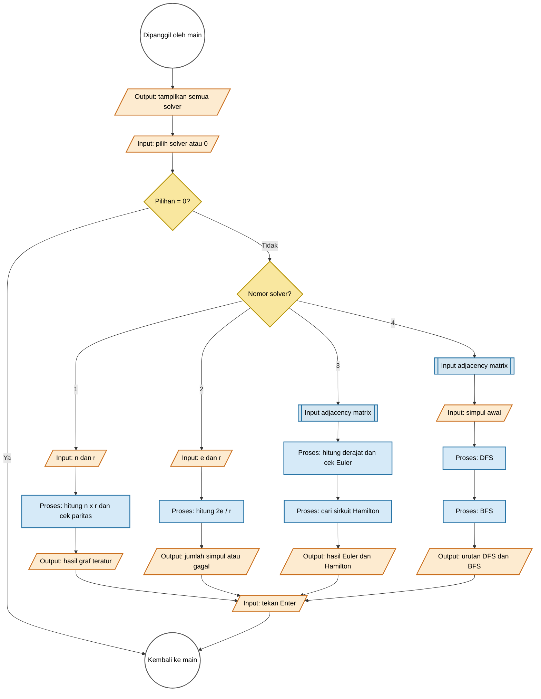
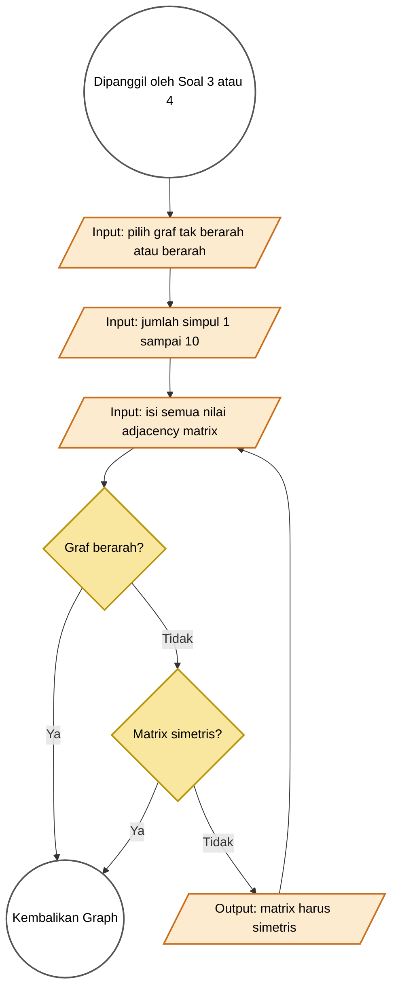

# Flowchart Program Graf

Dokumen ini menggambarkan alur `main.cpp` saat ini.

## Halaman 1 — Alur utama

## Halaman 2 — Pemilihan soal

## Halaman 3 — Daftar solver

## Halaman 4 — Input adjacency matrix

## Catatan

- Matrix menyimpan jumlah sisi; loop adalah nilai diagonal dan sisi ganda diperbolehkan.
- Soal 3 memeriksa sirkuit Euler. Untuk graf berarah, program memeriksa derajat masuk/keluar serta keterhubungan kuat pada simpul yang memiliki sisi.
- Soal 4 mengikuti arah sisi pada graf berarah dan memeriksa tetangga dari nomor terkecil.
- `verifyAlgorithms()` menjalankan `assert` untuk memeriksa DFS, BFS, keterhubungan Euler, dan Hamilton pada graf contoh enam simpul.
