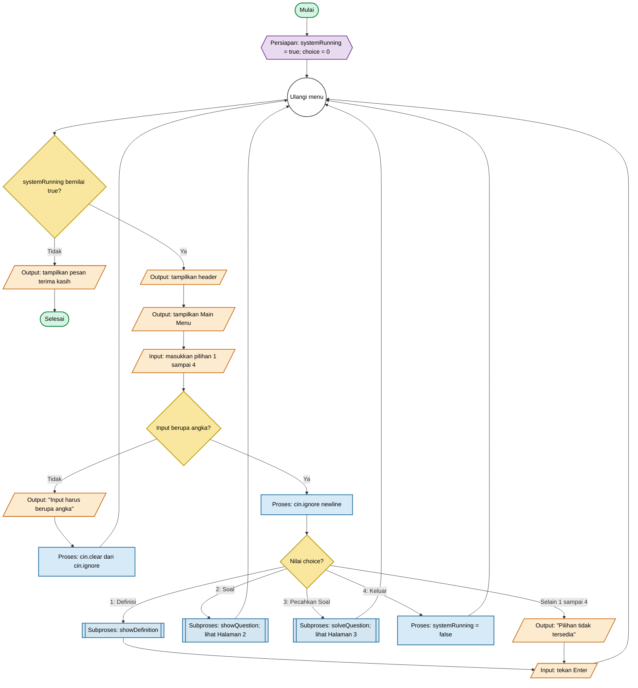
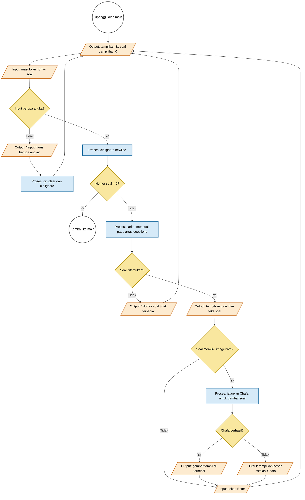
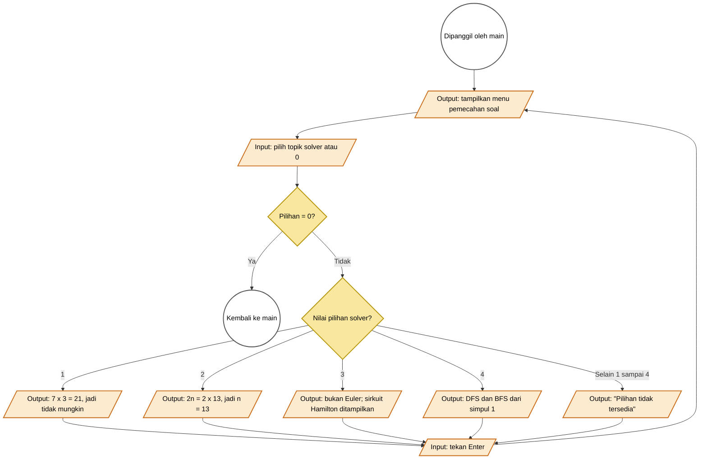

# Flowchart Program Graf

Dokumen ini menggambarkan **alur kode `main.cpp` saat ini**. Diagram dipecah menjadi halaman/subproses agar tetap mudah dibaca dan tidak memiliki garis yang saling berpotongan.

Konvensi yang dipakai mengikuti [Flowchart Drawing Specifications dari ProcessOn](https://www.processon.io/blog/flowchart-drawing-specifications): alur dari atas ke bawah, satu titik mulai pada diagram utama, teks ringkas, proses ber-input/output tunggal, serta setiap keputusan memiliki cabang berlabel.

Salin blok Mermaid ke [Mermaid AI](https://mermaid.ai/) bila ingin merender diagramnya.

## Halaman 1 — Alur utama `main()`

## Halaman 2 — Subproses `showQuestion()`

## Halaman 3 — Subproses `solveQuestion()`

## Shape convention

| Symbol | Mermaid form | Meaning |
|---|---|---|
| Terminator | `([ ... ])` | Only the main program start/end |
| Preparation | `{{ ... }}` | Variable or matrix initialization |
| Process | `[ ... ]` | Calculation or state-changing operation |
| Input/Output | `[/ ... /]` | Read input or write terminal output |
| Decision | `{ ... }` | One input, multiple labelled output branches |
| Subprocess | `[[ ... ]]` | A function detailed on another page |
| Connector | `(( ... ))` | Cross-page call/return point for a subprocess |

## Verification checklist

- The main diagram has one start symbol and one end symbol.
- Every decision has all of its outcomes labelled.
- All non-terminal paths return to the menu or to the calling process.
- Complex logic is split into subprocess pages instead of using crossed arrows.
- Every diagram flows from top to bottom with concise labels.

## References

- [ProcessOn — Flowchart Drawing Specifications](https://www.processon.io/blog/flowchart-drawing-specifications)
- `main.cpp` — source of the actual program flow
