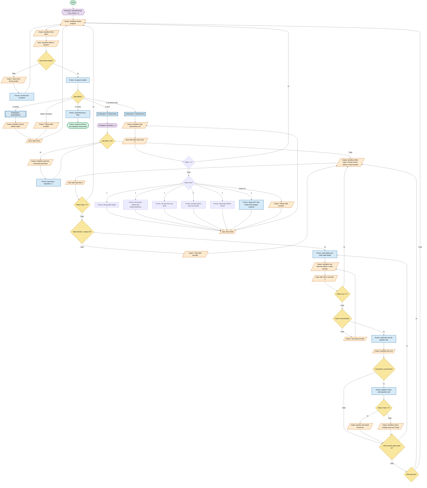

# Flowchart Program Graf

Flowchart ini memakai **konvensi standar flowchart** dan menambahkan alur pertanyaan yang lengkap untuk setiap topik. Salin blok Mermaid berikut ke [Mermaid AI](https://mermaid.ai/).

> **Catatan:** bagian alur pertanyaan adalah rancangan lengkap yang perlu diimplementasikan saat `showQuestion()` dikembangkan. Kode saat ini hanya menampilkan Soal 1. Tidak ada cabang yang sengaja dibiarkan tanpa tujuan.

## Konvensi flowchart

| Simbol | Bentuk Mermaid | Fungsi |
|---|---|---|
| Terminator | `([ ... ])` | Awal atau akhir program |
| **Preparation / initialization** | `{{ ... }}` | Inisialisasi variabel sebelum proses atau loop |
| Process | `[ ... ]` | Perhitungan atau operasi program |
| Input/Output | `[/ ... /]` | Membaca masukan atau menampilkan keluaran |
| Decision | `{ ... }` | Kondisi yang memiliki cabang Ya/Tidak atau beberapa pilihan |
| Subprogram | `[[ ... ]]` | Pemanggilan fungsi |

## Cakupan loop pertanyaan

1. `topicIndex` berjalan dari **1 sampai 18** supaya setiap topik dan soal terkait masuk ke daftar.
2. Pilihan topik yang salah kembali ke daftar topik.
3. Pilihan soal yang salah kembali ke daftar soal topik tersebut.
4. Setelah melihat soal, pengguna dapat melihat soal lain dalam topik yang sama, berpindah topik, atau kembali ke menu utama.
5. Setiap cabang sukses dan gagal pada Chafa kembali ke alur yang sama, sehingga tidak ada *error gap*.

## Referensi

- `example/TugasKelompokKombinasiDariBapakNovridoCharibaldiYangTerhormat.cpp`: struktur menu, validasi input, percabangan, dan loop kembali ke menu.
- `example/kombinasi.drawio`: penggunaan proses, input/output, keputusan, cabang, dan panah kembali.
- `main.cpp`: alur menu Graf saat ini.
