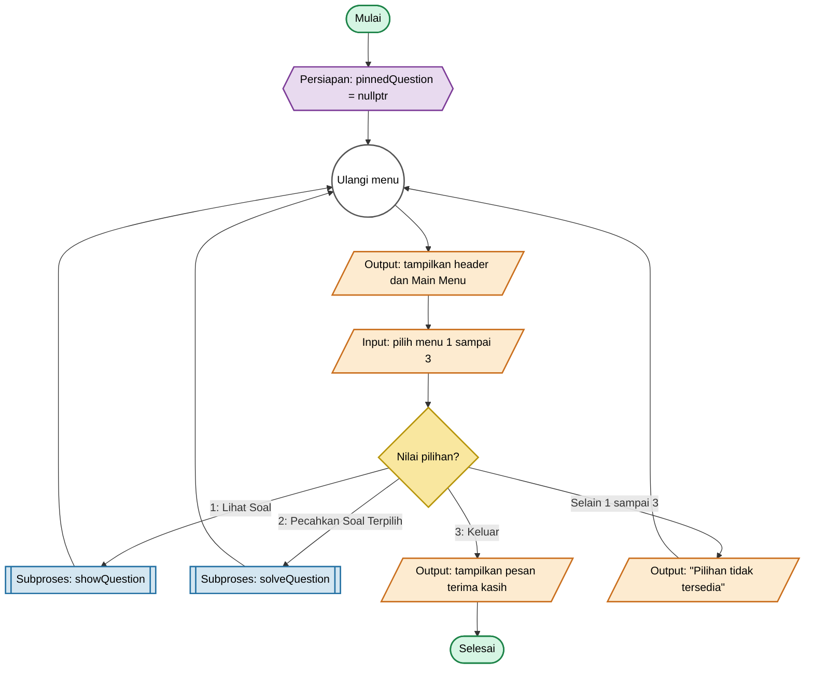
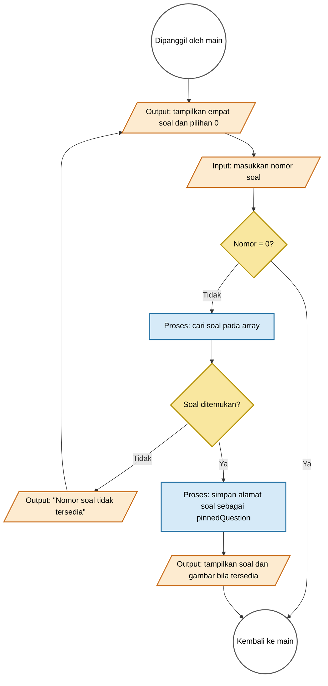
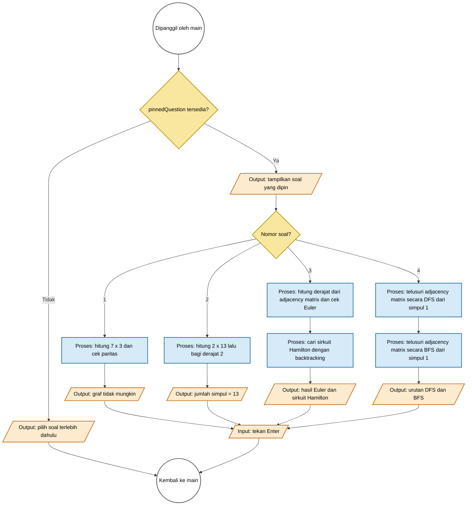

# Flowchart Program Graf

Dokumen ini menggambarkan alur `main.cpp` saat ini.

## Halaman 1 — Alur utama `main()`

## Halaman 2 — Subproses `showQuestion()`

## Halaman 3 — Subproses `solveQuestion()`

## Catatan implementasi

- `questionGraph` adalah adjacency matrix enam simpul yang dipakai bersama oleh Soal 3 dan 4.
- DFS dan BFS memeriksa tetangga dalam urutan nomor simpul menaik.
- `verifyQuestionGraph()` memakai `assert` untuk memeriksa derajat, urutan DFS/BFS, dan keberadaan sirkuit Hamilton saat program dimulai.
